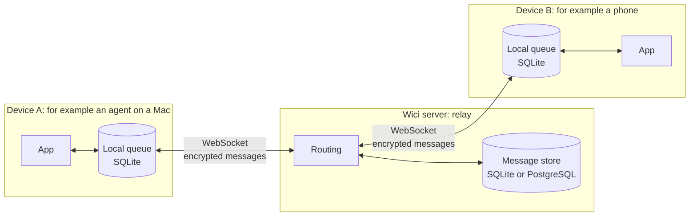
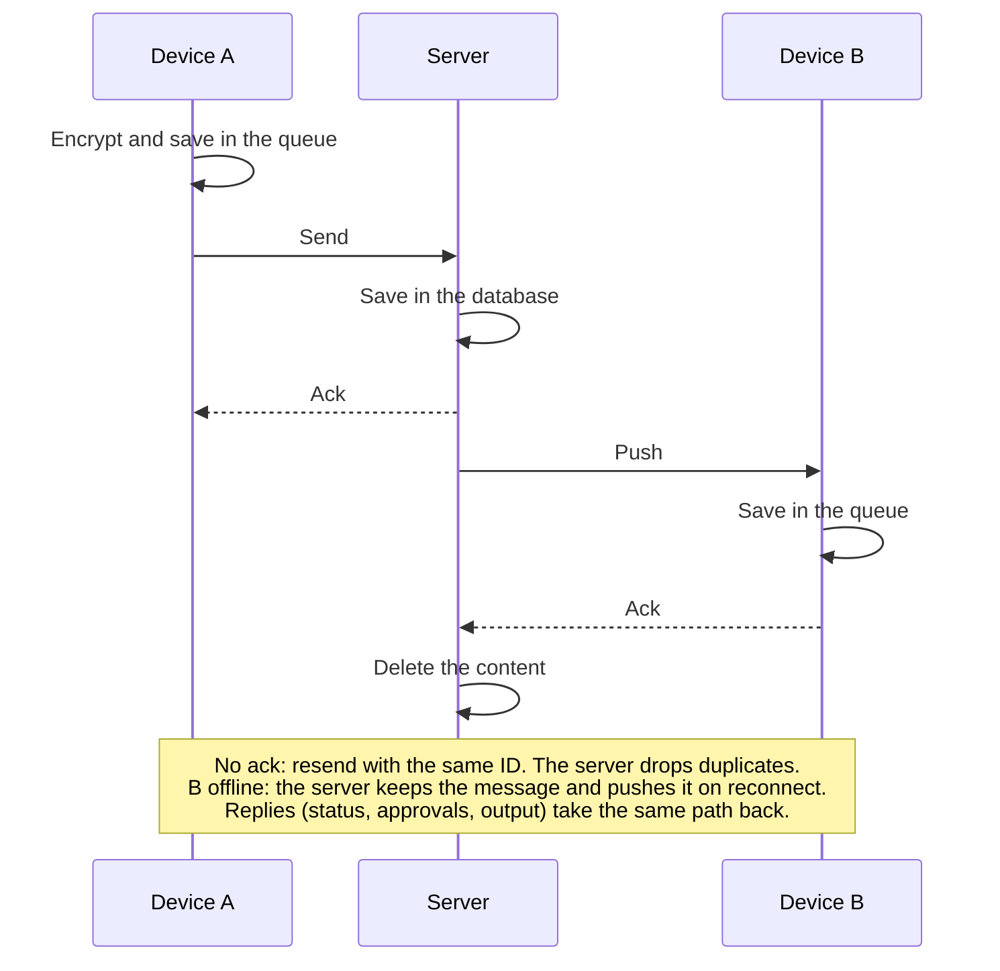

# Wici

A small protocol to send messages between two paired devices. For example,
an AI agent on a Mac sends its output to a phone, and the phone sends back
commands and approvals.



The path of one message:



- Devices pair once with a QR code or a link.
- Messages are end-to-end encrypted. The server cannot read them.
- Each device keeps a local queue. A lost connection loses no messages.
- A retry never runs a command twice.

Status: early. The server, the Rust client, and the Swift package work.
Read the [plan](docs/project-plan.md) for the details and the next steps.

## Run the server

```sh
WICI_DATABASE_URL=sqlite:wici.db cargo run --release -p wici-server
```

More: [development](docs/development.md), [code map](docs/code-map.md).

## License

Not chosen yet.
